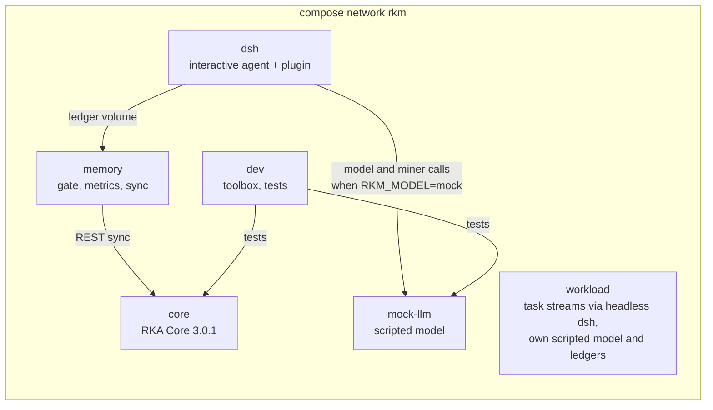

# Plan: a Docker Compose environment for developing and testing rka-memory

Status (2026-11-06): M1 to M3 are built, and so is M4's interactive profile (`make up`). M3 drives dsh headless rather than through ACP (see [WORKLOAD.md](WORKLOAD.md)). Live streams are built (`make live`, `workload/live/`); the first live run waits on a model key (decision 2). Elsewhere, "exists" marks what was built before this plan.

## Goal

One `docker compose` stack in which rka-memory is developed, tested at every level, and driven by a task workload. The stack is isolated from the host: its own RKA Core, its own ledger, its own model endpoint. It runs the same way every time, and it works even though your host Claude Code sessions are now sandboxed.

## The design driver: three principals

The ledger is only trustworthy if the recorder is its only writer (see the trust boundary in [LADDER.md](LADDER.md)). The stack keeps three principals apart, and every volume mount follows from that:

| Principal | Who | May write |
|---|---|---|
| User | the workload runner (plays the user: prompts, file edits, undos, `rkm` verdicts) and you | workspaces |
| Agent | dsh's tools (`bash`, `write`, `edit`), always in dsh's sandbox | workspaces only |
| Recorder | the rka-memory plugin and the memory service | ledger |

The ledger volume is mounted only into containers that run the recorder. The agent's tools never see it.

## Services

| Service | Image | Role | Host port | Volumes |
|---|---|---|---|---|
| `core` | built from your RKA Core source (`RKA_CORE_SRC`, default `/Volumes/FuSpace/Projects/rka-projects/rka`) | the stack's own Core; embeddings off in test runs | `127.0.0.1:9722` | `core-data` |
| `mock-llm` | small Python image | scripted OpenAI-compatible model for the agent and the miner; logs every request | none | `runs` |
| `dsh` | `rka-memory-dsh` (exists) | dsh `web` profile for you to watch and drive sessions by hand; plugin loaded; model chosen by `RKM_MODEL` | `127.0.0.1:3080` (`DSH_HOST_PORT`) | `ledger`, `dsh-home`, `workspaces` |
| `workload` | `rka-memory-dsh` plus the runner | runs task streams: drives headless dsh (ACP later), plays the user, advances a simulated clock, mines and gates after each session; each stream has its own ledger and scripted model | none | `runs` |
| `memory` | `rka-memory-dsh` | writes the stack config, creates the stack's Core project once, then gates, exports skills, writes daily metrics and syncs to `core` (`rka-memory jobs`) | none | `ledger` |
| `dev` | toolbox: Python 3.12, uv, Node 24, git | develop and test rka-memory; repository bind-mounted at `/src` | none | repository, `uv-cache` |

No container gets the Docker socket. Only `core` and `dsh` publish ports, and only on `127.0.0.1`.

Compose profiles select what runs:

- `test`: `core`, `mock-llm`, `dev`, `dsh-e2e`. Deterministic, no keys.
- `workload`: `workload`. Each stream starts its own scripted model and ledger inside the container.
- `interactive`: `core`, `mock-llm`, `memory`, `dsh`, with the mock or DeepSeek.

`make up` runs the interactive stack as compose project `rka-memory`. `make test` and `make scenarios` run as project `rka-memory-test`, with their own Core, volumes and network and an ephemeral Core port, so they never touch a running stack.

## The workload

A task is a small git repository template plus a session script:

- the prompt and follow-up prompts;
- for the mock model, the scripted tool calls; for a real model, nothing;
- the acceptance command;
- what the simulated user does afterwards: accept, edit (a diff), undo, `rkm confirm <id>`, `rkm reject <id> <reason>`;
- drift applied before the session, for example switching the project from `uv` to `pip`, moving the tests, or changing a stated preference.

A stream is an ordered list of tasks with simulated timestamps, so a run can cover weeks (60-day retirement, day-by-day A/B arms) in minutes. A stream can declare a temporal split: the ledger is frozen at time t and only later tasks are scored.

Scenario suites run on the mock model and assert ladder behavior end to end, through real dsh, the plugin and the engine:

1. promotion after grounding in two sessions; weak-only grounding needs three;
2. demotion after an undo or a typed `rkm reject`;
3. scope narrowing when the toolchain drifts;
4. dependency propagation when a delivered record is demoted;
5. a procedure reaching L3 after repeated successful use, then retiring on a failed acceptance check;
6. retirement of an untouched L1 record after 60 simulated days;
7. A/B arms alternating by simulated day, with rediscovery tokens measured per arm;
8. forgery attempts by the agent (the existing sandbox check, run inside the stack);
9. a later session adding its evidence to an existing record through a support link, which the first live run showed a real miner needs (added after M4);
10. reads of the ledger and the run directory by the agent, through the shell and through dsh's own file tools, which the second clean house-rules run showed a no-memory session doing (added after M4);
11. a rule the user states in a message, recorded in the user's own words and given evidence each time the user repeats it, which the live house-rules runs showed the full-session miner missing (added after M4).

Live streams use a real model and produce metrics, not pass/fail: a personal-agent task set over simulated weeks first. A coding benchmark subset (for example SWE-bench Lite) is possible later, but the prototype spec keeps benchmark harnesses out of scope.

Each run writes a manifest (image digests, config, model ids, seed), the ledger snapshot, the metrics JSON and per-task results to the `runs` volume.

## Code changes the stack needs

1. **Simulated clock.** `RKA_MEMORY_NOW` (or a clock file) drives event timestamps, the gate's `now`, arm rotation and the metrics date.
2. **A miner backend that works in containers.** `openai_compat` calls any OpenAI-compatible chat endpoint: the mock in tests, DeepSeek or another provider in live runs. The `claude` CLI is not available in containers.
3. **Inline background work.** A config switch so the workload mines and gates synchronously after each session instead of spawning background processes. The ledger order then follows the stream exactly.
4. **The workload runner.** An ACP client for dsh, the user simulator, the task and stream format, assertions and reports.
5. **A scenario-driven mock model.** Generalizes `scripts/mock_openai.py` (exists) to per-task scripts for the agent and canned outputs for the miner.

## Test tiers

| Tier | Runs in | Covers |
|---|---|---|
| T0 unit | `dev` | the Python and plugin unit tests (exist) |
| T1 integration | `dev`, `dsh` | Core sync and pull against `core`; the real-dsh plugin check (exists) |
| T2 scenarios | `workload` | the scenario suites above, mock model, assertions on rung transitions |
| T3 security | `workload` | forgery attempts by the agent inside the stack |
| T4 live | `workload` | real-model streams (`make live`); harness checks, then a report of rungs and metrics instead of assertions |

`make test` runs T0, T1 and the forgery check under the `test` profile. `make scenarios` runs T2 and T3 under the `workload` profile. T0 and T1 then also run where the host sandbox blocks them today (local ports, the Docker socket).

## Milestones

| | Builds | Done when |
|---|---|---|
| M1 | compose file, `core` from source, `dev` toolbox, `mock-llm`, `make test` for T0 and T1 | `make test` passes in containers |
| M2 | simulated clock, `openai_compat` miner, inline background mode | unit tests; the miner runs against `mock-llm` |
| M3 | workload runner, headless dsh driver (ACP later), task and stream format, the eight scenario suites, T3 | all scenarios pass on the mock model |
| M4 | `interactive` profile (built: `make up`, checked by `make check-up`); live streams with a real model (built: `make live`; first run waits on decision 2) | one live stream with a metrics report |

## Decisions needed

1. **Who runs Docker.** Decided 2026-11-06: allow the Docker socket in Claude Code's sandbox (`sandbox.network.allowUnixSockets`). Any Claude Code session can now start a container that mounts `~/.rka-memory`, so the host ledger boundary is open again through Docker. `scripts/dockerw` runs the docker CLI with its client state in a temp dir, so builds work without widening the sandbox further.
2. **Model for live runs.** dsh's native provider is DeepSeek. Do you have an API key for the workload and for the miner, or another OpenAI-compatible endpoint?
3. **Workload content.** Synthetic personal-agent tasks that we write first, or a coding benchmark subset as well?
4. **Core.** The stack's own isolated Core only (default), or also sync to memo-rka-agent on your host Core?
5. **Dogfooding.** Keep host Claude Code dogfooding running, or move daily use into the stack's dsh?
